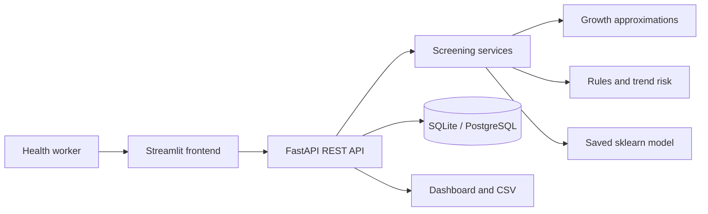
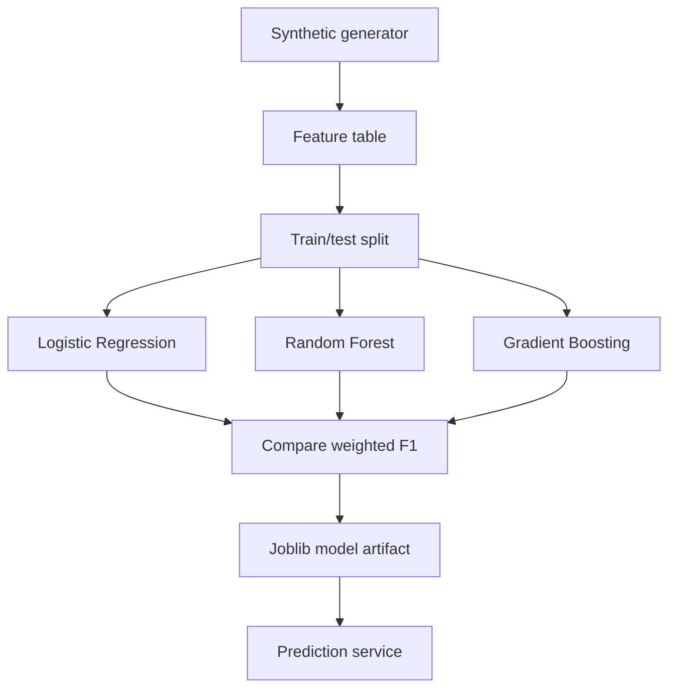
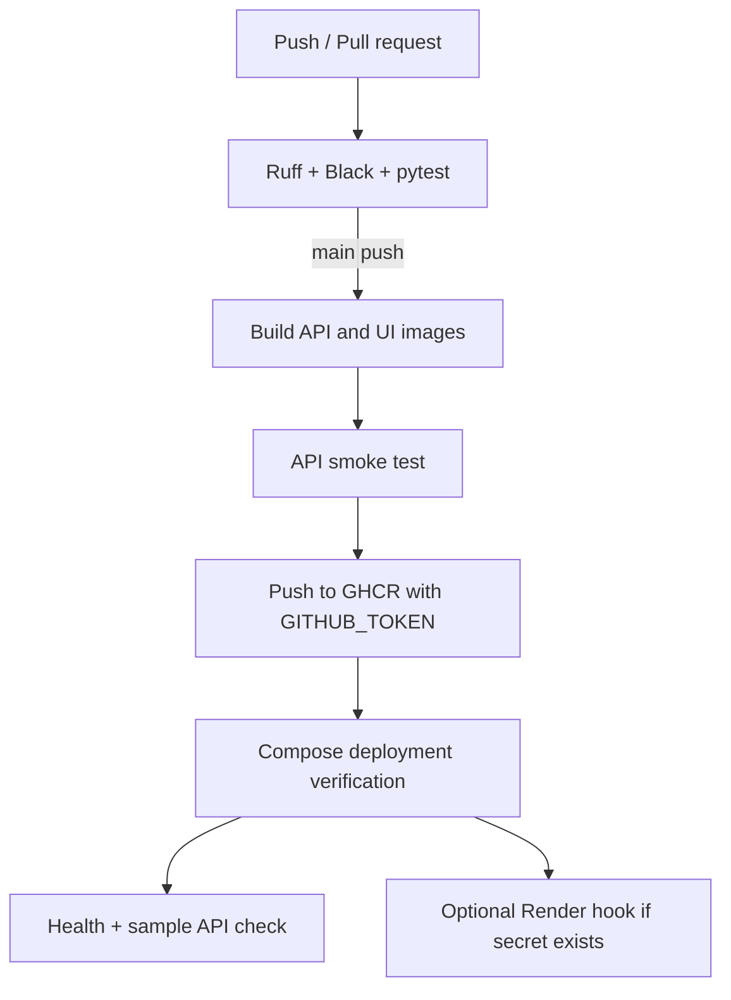

# Architecture

## Data flow
A health worker signs in with the seeded demo account, registers a child and records a visit. The API validates input, loads the child's sex, calculates simplified growth indicators, applies status rules and computes a history-based risk score. The visit is persisted and the result includes contributing indicators and cautious recommendations. Dashboard endpoints aggregate visits.

## ML pipeline

## CI/CD pipeline

The implementation uses SQLite for local development and PostgreSQL for Docker Compose. The synthetic model is for demonstration, while API category decisions use deterministic rules for transparency.
