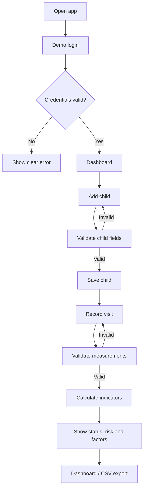

# User flow

Use plain-language labels, visible field units, inline errors, keyboard-friendly controls and green/amber/red status colors paired with text labels. The layout should reflow to a single column on narrow screens.
